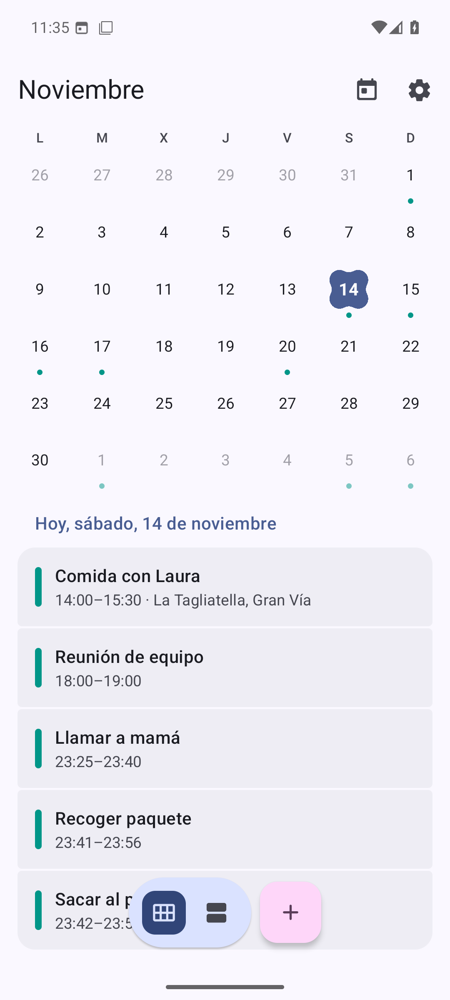
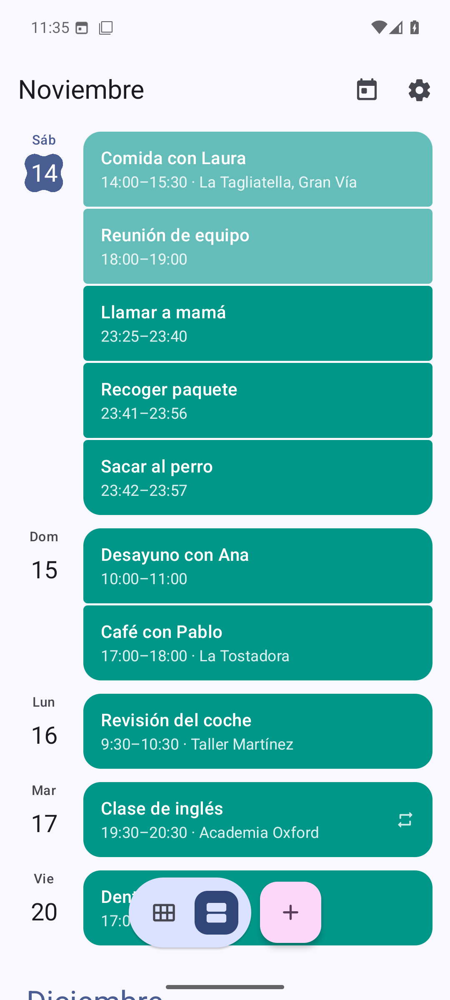
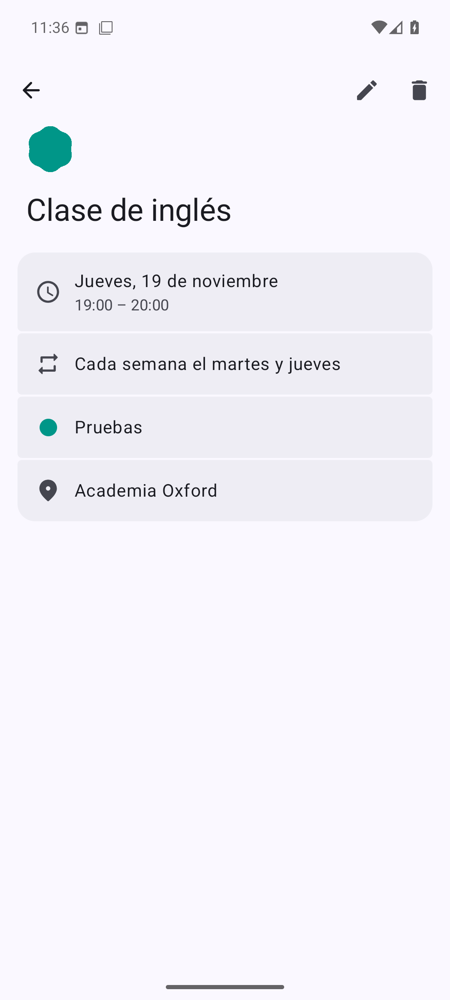
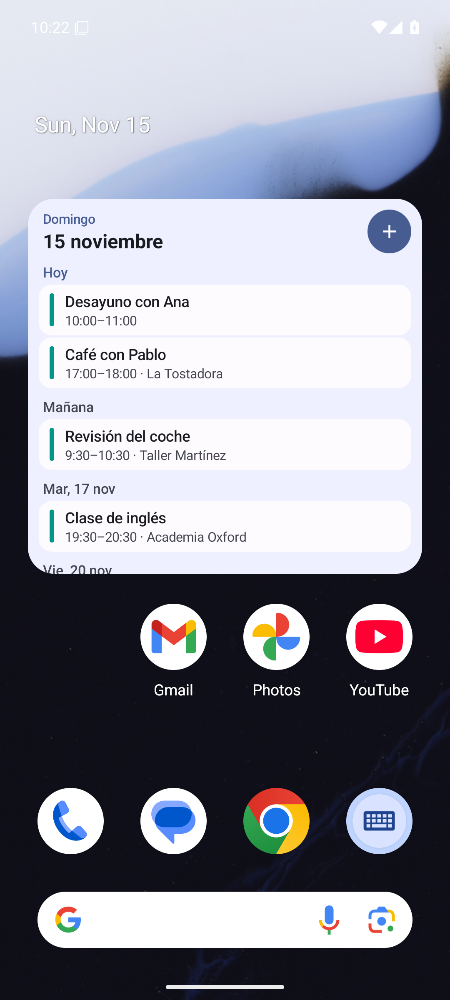

# Calendar

A simple calendar app for Android, built with Kotlin and Jetpack Compose (Material 3 Expressive / Material You).

It shows and edits the events of the calendars your accounts sync to the phone (Google, your own CalDAV server, Exchange…) through Android's calendar provider. It has **no internet permission**: the accounts' own sync adapters upload your changes.

<p align="center">
  
  
  
  
</p>

## Features

### Month and agenda
- **Month:** swipe between months; each day shows a dot per calendar with events, and the selected day's events are listed under the grid.
- **Agenda:** a continuous list of the coming days with events, by month, each event filled with its calendar's color.
- Today is always one tap away, and the app opens in the view you used last.

### Events
- Create, edit and delete events: title, all day, start and end, repeat, reminders, location and description, in any calendar you can write to.
- Repeating events: daily, every weekday, weekly, monthly (on a day or on the second Saturday…) or yearly. Rules made by other apps are kept and described ("Every 2 weeks on Monday and Thursday, until 3 Dec").
- Changing or deleting one occurrence of a repeating event asks whether it is for this event, this and the following ones, or all of them.
- Opens from other apps: "Add to calendar" buttons, event links and calendar dates.

### Reminders
- Notifications for event reminders, with snooze. Android's calendar provider sets the alarms; the app shows them.

### Widget
- An agenda for the home screen: today's date, a button for a new event and your coming events: the next 30 days, or up to a year ahead when those hold only a few. It updates when your calendars sync, at midnight and when you change something in the app.

### Settings
- Choose which calendars to show, the calendar for new events, the default reminder and the first day of the week.
- Theme: system, light or dark, plus wallpaper (dynamic) colors on Android 12+.
- English and Spanish, with per-app language selection on Android 13+.

## Install

Download the APK from the [latest release](https://github.com/hostyn/calendar/releases/latest) and open it on your phone (Android 8.0 or later). Then open the app and allow access to your calendar and notifications.

Releases are signed with this certificate. You can check it with [AppVerifier](https://github.com/soupslurpr/AppVerifier) or `apksigner verify --print-certs`:

```
dev.hostyn.calendar
EC:D6:BD:FC:52:58:65:A9:B5:C3:00:A7:60:5F:9F:E3:B6:B7:70:F2:84:50:16:C6:63:8D:06:B8:F0:C5:64:36
```

## Building

Requirements: JDK 17 and the Android SDK.

```bash
./gradlew installDebug         # build and install a debug build on a connected device
./gradlew testDebugUnitTest    # unit tests (repeat rules, durations, dates)
./gradlew assembleRelease      # unsigned release build, minified with R8
```

Besides `debug`, there is a `dev` build type: optimized like a release but signed with the debug key, installed next to the released app as "Calendar dev".

To make a signed release, run `scripts/release.sh`. It builds the release, signs it with the key in `~/keystores/phone-release.p12` (or the path you pass as the first argument), asking for the password, and writes `dist/calendar-<version>.apk`.

## Tech stack

- Kotlin, Jetpack Compose, Material 3 Expressive, Navigation Compose
- Android's calendar provider (`CalendarContract`): calendars, instances, events, reminders and alerts
- [Jetpack Glance](https://developer.android.com/develop/ui/compose/glance) for the home-screen widget

## Project structure

```
app/src/main/java/dev/hostyn/calendar/
├── data/        Calendars and events (calendar provider), repeat rules, settings
├── reminders/   Reminder notifications and snooze
├── widget/      Home-screen agenda widget and its updates
└── ui/          Compose screens: month, agenda, event, editor, settings
```

## License

Copyright (C) 2026 Rubén Martínez Hostyn

This program is free software: you can redistribute it and/or modify it under the terms of the GNU General Public License as published by the Free Software Foundation, either version 3 of the License, or (at your option) any later version. See [LICENSE](LICENSE) for the full text.
